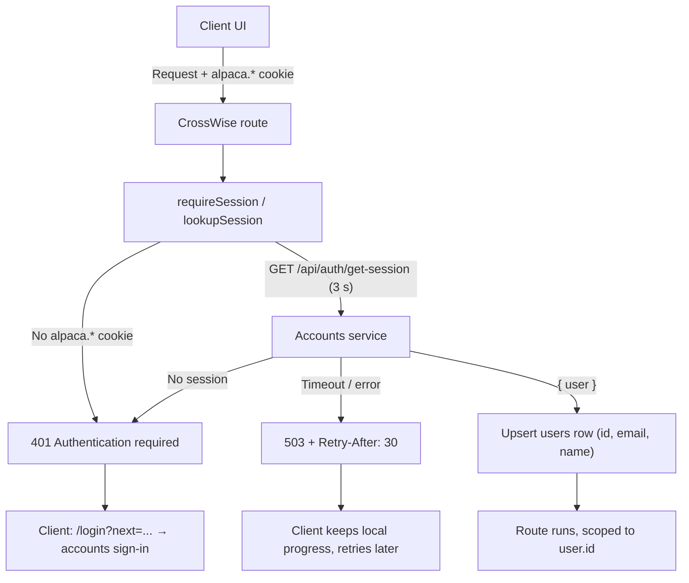
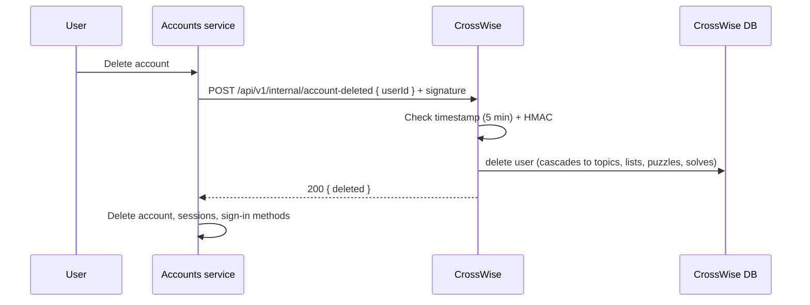

# Auth & Session Hydration Flow

## Purpose
Explain how users sign in, how CrossWise learns who they are, and how the client hydrates
user state. Sign-in lives in the shared Build Your Alpaca accounts service (ADR-009, #127).

## Entry Points
- `/login`, `/register`, `/forgot-password`, `/reset-password`, `/account` (redirect pages)
- `GET /api/v1/auth/session`
- `POST /api/v1/auth/logout`
- `POST /api/v1/internal/account-deleted` (called by the accounts service)

## Primary Actors
- Client UI (Next.js)
- Accounts service (`https://accounts.buildyouralpaca.com`, Better Auth)
- CrossWise API routes and `requireSession`
- Prisma + database

## Sign-in (redirect)
1. A signed-out user opens a page that needs a session. The page sends them to
   `/login?next=<current path>`. The header's "Sign in" and "Create account" links go to
   `/login` and `/register`.
2. `/login`, `/register` and `/forgot-password` redirect to the accounts service's
   `sign-in`, `sign-up` and `forgot-password` pages. `/reset-password` goes to
   `forgot-password` too, since old CrossWise reset links no longer work.
3. The redirect carries a return link: `redirect=<APP_URL><next>`. `next` is sanitized to a
   same-origin path (falls back to `/topics`).
4. The user signs in with Google, GitHub, or email + password. Email accounts must confirm
   their address first. Reset email goes through Resend. Sign-in is rate limited per IP.
   Accounts are for ages 13 and up.
5. The accounts service sets `__Secure-alpaca.session_token` for `buildyouralpaca.com`
   (`httpOnly`, `Secure`, `SameSite=Lax`) and sends the user back to CrossWise.

`/account` redirects to the accounts page (account settings, sign-in methods, deletion).
The header's name links to it.

## Session lookup
1. Every request to `crosswise.buildyouralpaca.com` carries the shared cookie.
2. `lookupSession` in `src/lib/auth.ts` forwards only the `alpaca.*` cookies to
   `GET {ACCOUNTS_URL}/api/auth/get-session`, with a 3 s timeout.
3. If the service returns a user, CrossWise creates or updates its local `users` row (id,
   email, name) so topics and solves keep their foreign keys. User ids are the
   accounts-service ids.
4. The root layout (`src/app/layout.tsx`) runs the lookup and passes the user to
   `AuthProvider`, which hydrates the store. If the lookup fails, the layout renders signed
   out and logs the error.
5. `AuthProvider` calls `GET /api/v1/auth/session` once per page load. That route passes the
   accounts service's refreshed session cookie on to the browser, so daily users stay
   signed in.
6. API routes call `requireSession(request)` from `src/lib/api-auth.ts` (#88):
   - signed in → the user;
   - no cookie or no session → **401**;
   - accounts service unreachable or erroring → **503** with `Retry-After: 30`.

The 503 is not "signed out". The solve page keeps progress in `localStorage` and the next
save tries again, instead of sending the user to sign in.

## Sign-out
1. The header's "Sign out" calls `POST /api/v1/auth/logout`.
2. CrossWise calls the accounts service's `POST /api/auth/sign-out` with the `alpaca.*`
   cookies and `origin: APP_URL`.
3. The response's cookie-clearing headers are passed to the browser. This signs the user out
   of the shared account, in every Build Your Alpaca app.

## Account deletion webhook
1. The user deletes their account on the accounts service.
2. Before deleting, the accounts service calls `POST /api/v1/internal/account-deleted` with
   body `{ userId }` and headers:
   - `x-alpaca-timestamp`: unix seconds;
   - `x-alpaca-signature`: `v1=<hex HMAC-SHA256 of "<timestamp>.<body>">`, keyed with
     `ACCOUNT_WEBHOOK_SECRET`.
3. CrossWise refuses timestamps more than 5 minutes off and bad signatures (401), then
   deletes the `users` row. Topics, lists, puzzles and solves cascade with it.
4. A repeat delivery succeeds with `{ deleted: 0 }`.
5. If CrossWise can't confirm, the accounts service refuses to delete the account and the
   user tries again.

## Data Artifacts
- Cookie: `__Secure-alpaca.session_token` (set by the accounts service for
  `buildyouralpaca.com`)
- User row: `users` table (id, email, name). `password_hash` is nullable and unused.
- Unused since ADR-009, dropped by a later contract migration: `sessions` and
  `password_reset_tokens` tables, `users.password_hash`.

## Failure Modes
- Signed out -> 401 from API routes; `{ user: null }` from `GET /api/v1/auth/session`.
- Accounts service unreachable -> 503 with `Retry-After: 30` from API routes, the session
  route and logout. Local solve progress is kept.
- Account-deleted webhook with a bad signature or stale timestamp -> 401; missing `userId`
  -> 400; `ACCOUNT_WEBHOOK_SECRET` not set -> 503.

## Key Files
- `src/lib/auth.ts` (session lookup, sign-out, local user row)
- `src/lib/api-auth.ts` (`requireSession`, 401/503 responses)
- `src/lib/accounts-redirect.ts` (redirects to the accounts service)
- `src/app/api/v1/auth/session/route.ts`
- `src/app/api/v1/auth/logout/route.ts`
- `src/app/api/v1/internal/account-deleted/route.ts`
- `src/app/login/page.tsx`, `src/app/register/page.tsx`, `src/app/forgot-password/page.tsx`,
  `src/app/reset-password/page.tsx`, `src/app/account/page.tsx`
- `src/app/layout.tsx`, `src/components/AuthProvider.tsx`
