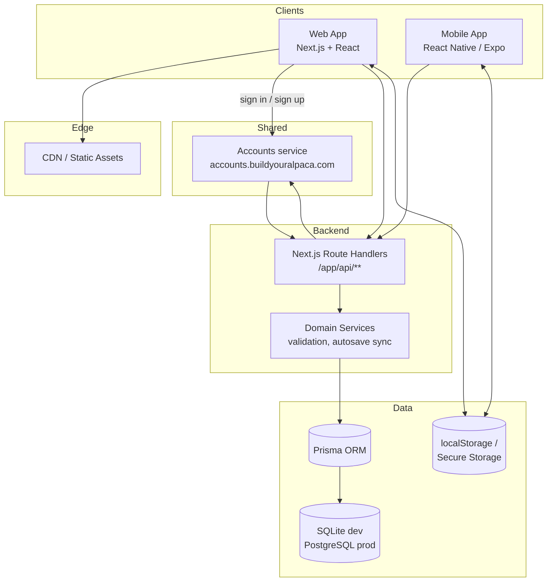

# System Architecture (Web + Mobile)

CrossWise serves both a web client (Next.js) and a mobile client (React Native / Expo) that share the same API surface and persistence model. Offline-friendly solve state lives on each device and syncs to the server when sessions are available.

## Interaction Notes
- Web signs in on the shared accounts service (ADR-009). Its session cookie is set for `buildyouralpaca.com`, and CrossWise asks the service who the cookie belongs to on each request (`requireSession`). How a mobile client signs in is not decided yet.
- Both clients cache puzzle data and autosave solve state locally, then sync via the `/api/v1/puzzles/:id/solve` endpoint when online.
- Background tasks are minimal; route handlers orchestrate validation, persistence, and autosave reconciliation in-process.
